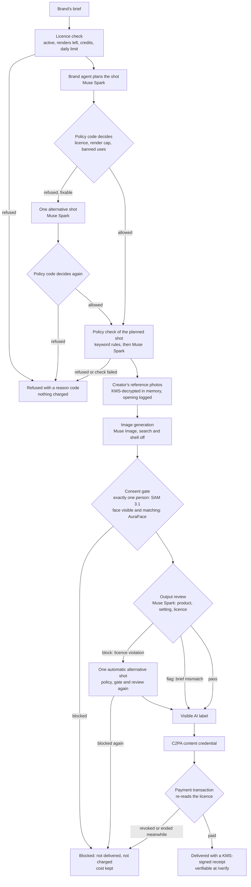
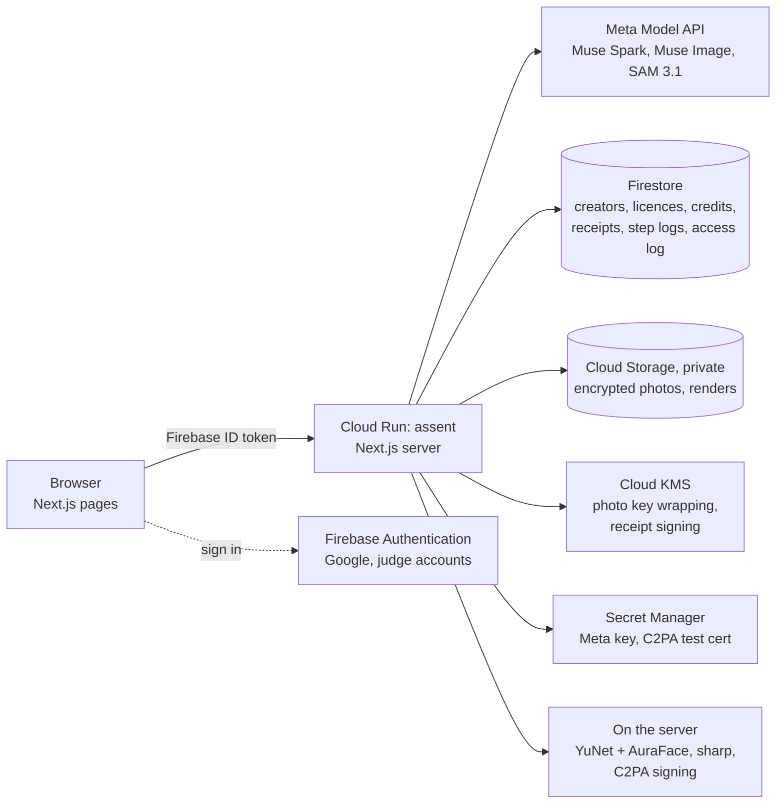

# Assent

**Your face. Your terms. Your yes.**

Brands want ads with real people in them. AI can now make those images in under a minute, and nothing stops
it from using someone's face without asking. Assent makes consent the thing a render can't skip. A creator
licenses their likeness to one brand at a time, on their own terms. The brand's AI agent plans each image,
and code checks the plan against the licence before any photo is opened. After Meta's Muse Image makes the
image, a SAM 3.1 consent gate checks that the only person in it is the licensed creator. The image is then
labelled, signed and paid for per use. The creator can revoke at any time, and anyone can check a file at
`/verify`.

- **Live:** https://assent-1000899129252.us-central1.run.app
- **Demo video:** https://youtu.be/uQ8K6itjA6o
- **Built for:** Meta Global AI Developer Hackathon, Indie track
- **Runs on:** Meta Muse Spark, Muse Image and SAM 3.1, on Google Cloud (Cloud Run, Firestore, Cloud Storage,
  Cloud KMS, Secret Manager, Firebase Authentication)

## Test it in 5 minutes

The judge accounts' emails and passwords are in the submission form. They are never in this repository.

1. **Open the live URL** and press **Get started**. Under "Sign in with Google" is the form for judges. Sign
   in there as the brand, **Brew & Co.**
2. **Make an image ad.** On the dashboard, Brew & Co. holds a licence for **Maya Okafor**, a synthetic demo
   creator (a generated face, not a real person). Write a brief or press "Write it for me", then press **Make an
   image ad**. A live timeline shows each step as it runs, with how long it took and what it cost:
   - **Brand agent plan:** Muse Spark turns the brief into a shot, and the policy code decides whether it's
     allowed.
   - **Policy check:** keyword rules run first, then a Muse Spark check of the planned shot.
   - **Creator's reference photos:** decrypted with Cloud KMS, and the opening is logged.
   - **Image generation:** Muse Image makes the image.
   - **Consent gate:** SAM 3.1 counts the people in it and AuraFace matches the face. The step shows its figure.
   - **Output review:** Muse Spark checks the image against the shot and the licence.
   - **AI-generated label, Content credential (C2PA), Receipt and payment:** the visible label, the C2PA
     credential, and the payment with its KMS-signed receipt.

   Expect about **40–50 s**.
3. **Open "Steps and consent check"** on the render card. It reopens the same timeline, including the consent
   figure with each detected person's box and match score.
4. **Verify the file.** Press **Download**, then upload the file at **Verify**. Expect **Licensed**, a valid
   Cloud KMS receipt, and a content credential that is intact and matches the receipt. The page also notes that
   the credential uses a test certificate, which is expected (see [Known limitations](#known-limitations)).
5. **Revoke as the creator.** Sign out, then sign in as the creator (Maya Okafor) and press **Revoke** on the
   Brew & Co. licence. Sign back in as the brand and try another ad. It is refused straight away, before any
   model call, and nothing is charged.
6. **Press Reset demo** on the brand's dashboard. The licence is active again with 0 renders used, and the
   brand's credits are back to 2,000.

**What a render costs.** About **$0.03–0.04** in model calls. Each step's estimated cost is shown in the
timeline: in the eval, the plan cost $0.005, the policy check $0.006, Muse Image $0.010, SAM 3.1 $0.0025 and the
review $0.007. Brands pay in demo credits, not money. Daily limits apply in UTC days: 25 renders for the judge
brand, 3 for any other brand and 40 site-wide. If a limit is reached, the error card says when to try again.

## The problem, and what Assent does

AI image models can put anyone's face in an ad. A creator whose face is valuable has no way to say yes on
their own terms, or to say no. Brands also have no clean way to prove they had permission, and viewers can't
tell a licensed AI ad from a fake one.

Assent puts consent, payment and proof around every image:

- **Creators set the terms.** They choose the allowed uses, a price per image and a number of renders.
  Political, adult, minor-related, impersonating and deceptive uses are refused under every licence. Each
  brand asks for a licence, and the creator approves each one.
- **Every render checks the licence, the brief and the result.** The brief is checked before any photo is
  opened. The finished image must show exactly one person, and that person must be the licensed creator.
  An image that fails isn't delivered and isn't charged.
- **Every image carries proof.** Each image gets a visible "AI-generated · licensed likeness" label, a C2PA
  content credential naming the licence, and a receipt signed with Cloud KMS. Anyone can check a file at
  `/verify` and see **Licensed**, **Revoked**, **Expired** or **Unknown**.
- **Creators stay in control.** They see every image made with their face and every time their photos were
  opened. They can revoke a licence at any moment, and the next render is refused.

## How Meta's models are used

**The model proposes, the code decides.** The models plan, check and look at images, but none of them can
allow a render. Plain code does that, in [`lib/server/ai/policy.ts`](lib/server/ai/policy.ts) and
[`lib/server/consentGate.ts`](lib/server/consentGate.ts). Code checks the brand agent's shot against the
licence, the render cap and the banned uses. It treats any failure of the policy check as a refusal. It applies
the reviewer's verdict, and it passes the consent gate only on exactly one person whose face matches the
creator's.

| Meta model | Used for | Files |
|---|---|---|
| Muse Spark (`muse-spark-1.3`) | **Brand agent:** turns the brief into a shot, structured JSON only | [`lib/server/ai/meta/spark.ts`](lib/server/ai/meta/spark.ts) (`planShots`), [`lib/server/ai/policy.ts`](lib/server/ai/policy.ts) |
| Muse Spark | **Policy check** of the planned shot, after the keyword rules; any failure refuses the render | [`lib/server/ai/meta/spark.ts`](lib/server/ai/meta/spark.ts) (`checkPolicy`), [`lib/server/filter.ts`](lib/server/filter.ts), [`lib/server/rules.ts`](lib/server/rules.ts) |
| Muse Spark | **Output reviewer:** compares the finished image with the shot and the licence. It passes the image, flags it (delivered with a warning), or blocks it | [`lib/server/ai/meta/spark.ts`](lib/server/ai/meta/spark.ts) (`sparkReviewer`), [`lib/server/render-image.ts`](lib/server/render-image.ts) |
| Muse Spark | **Alternative shot:** one new proposal after the policy code refuses a shot, after a reviewer's block (automatic), or after a flag when the brand asks; checked again like the first | [`lib/server/ai/meta/spark.ts`](lib/server/ai/meta/spark.ts) (`reviseShot`), [`lib/server/ai/alternative.ts`](lib/server/ai/alternative.ts) |
| Muse Image (`muse-image-1.0`) | **Generation:** edits from the creator's consented reference photos. Image search, web search and shell are always off | [`lib/server/ai/meta/image.ts`](lib/server/ai/meta/image.ts) |
| SAM 3.1 (`sam-3.1`) | **Consent gate:** finds every person in the generated image (count, boxes, masks decoded in memory). Only one person passes | [`lib/server/ai/meta/sam.ts`](lib/server/ai/meta/sam.ts), [`lib/server/ai/meta/samFormat.ts`](lib/server/ai/meta/samFormat.ts), [`lib/server/consentGate.ts`](lib/server/consentGate.ts) |

These parts don't use Meta's models:
- **Face match:** YuNet and AuraFace run on the server ([`lib/server/facematch.ts`](lib/server/facematch.ts),
  [`lib/server/facecheck.ts`](lib/server/facecheck.ts)).
- **Everything else stays on Google Cloud:** licences, credits, receipts, storage and sign-in.
- **The fallback provider:** Gemini on Vertex AI remains as a fallback (`AI_PROVIDER=google`); the submitted app
  runs on Meta.

## Architecture

### The render pipeline



Each step writes an entry to the render's step log with its status, latency, model, estimated cost and reason
code. The brand sees it as the live timeline, and admins see it at `/admin`. Images and reference photos never
go into logs. A request carries an id from the browser, so a repeated click returns the first result and never
generates or charges twice.

### Infrastructure



- **Cloud Run** runs the Next.js app (pages and API routes) in one container. The face models are baked into the image.
- **Firestore** holds accounts, creators and their terms, licences, the credit ledger, receipts, render step logs and the photo access log.
- **Cloud Storage** holds each creator's reference photos, encrypted with a key wrapped by Cloud KMS, plus the renders and previews.
- **Cloud KMS** does the photo envelope encryption, and an asymmetric P-256 key signs each render's receipt.
- **Secret Manager** holds the Meta API key and the C2PA test certificate and key.
- **Firebase Authentication** handles sign-in with Google, plus email and password for the two judge accounts.
- **C2PA** credentials are signed with `@contentauth/c2pa-node`.

## Results

One evaluation run with Meta's models on 2026-10-29 at 19:36 UTC: 22 cases, 6 generated images
([`eval/results.md`](eval/results.md)). Settings were Muse Image reasoning strength low, and Muse Spark
reasoning effort low for the plan and the review, with Meta's default (high) for the policy check. It is a
small sample: one run, with one image per valid brief.

| Measure | Result |
|---|---|
| Correct refusals | 9/9: 8 banned briefs (4 refused by the keyword rules, 4 written to get past them and refused by Muse Spark) and 1 outside the licence |
| Valid briefs delivered | 6/6, none wrongly refused or blocked |
| Consent gate | 5/5: the creator passed (match 0.95). Two people, a wrong face (0.16), no person, and a face cut off by the edge were all blocked |
| Output reviewer | 2/2 on fixed images: the wrong product was flagged, and a matching image passed |
| Average latency per image | 50.3 s (6 images) |
| Average estimated cost per image, blocked included | $0.0315 |
| Estimated cost of the run | $0.22 (22 cases, 42 Meta calls) |

Per step (generated images, first attempt; means):

| Step | Time | Est. cost |
|---|---|---|
| licence | 0.7 s | – |
| plan (Muse Spark, low) | 6.5 s | $0.0053 |
| policy (Muse Spark, default) | 8.8 s | $0.0064 |
| photos | 2.3 s | – |
| generate (Muse Image) | 17.2 s | $0.0100 |
| consent (SAM 3.1 + AuraFace) | 3.4 s | $0.0025 |
| review (Muse Spark, low) | 6.7 s | $0.0073 |
| label, credential, payment | 4.8 s | – |

The live service now takes 41–51 s per render: 41 s and 50.8 s in the two checks on 1 Nov 2026.

**All results files**
- [`eval/results.md`](eval/results.md): the final run (above).
- [`eval/results-policy.md`](eval/results-policy.md): the **policy check alone**, with no plan, at its
  default effort. It refused all 4 banned briefs the keyword rules miss ($0.03).
- [`eval/results-spark-default.md`](eval/results-spark-default.md): Muse Spark at its default effort for
  every call. Same results, but 62.7 s and $0.0443 per image.
- [`eval/results-spark-low.md`](eval/results-spark-low.md): the policy check at medium effort. Same results,
  57.0 s and $0.0390 per image, so the final settings keep the default for policy.
- [`eval/results-dryrun.md`](eval/results-dryrun.md): a free dry run with the fixture provider. It checks the
  harness and is **not** results.

The cases are in [`eval/briefs.json`](eval/briefs.json). The consent-gate cases use synthetic faces only,
listed in [`eval/fixtures/README.md`](eval/fixtures/README.md).

## Consent, privacy and safety

- **Photos open only after the policy check.** The creator's reference photos are decrypted only after the plan
  and the policy check have passed. A refused brief never decrypts them and leaves no entry in the creator's
  access log.
- **Nothing is kept on Meta's side.** Every Muse Spark and Muse Image call sends `store: false`. SAM 3.1 calls
  send it too: Meta's SAM docs don't list it, but Meta accepted it and echoed it back.
- **No uploads.** Images go to Meta as base64 data URLs, never through the Files API, so nothing needs deleting
  afterwards.
- **Masks and other people's faces are never stored.** SAM's masks are decoded in memory and dropped; the
  consent figure keeps only the boxes. Face embeddings of anyone other than the creator are compared once to
  block the image, then zeroed. The decrypted reference photos and the creator's embeddings are zeroed after
  each render.
- **Synthetic creators only, on free credits.** On free credits, Meta may use inputs for product improvement.
  Only synthetic creators (generated faces, no real person) are sent to the Meta API in this demo. A production
  deployment would use paid billing with that turned off.
- **A visible label.** "AI-generated · licensed likeness" is burned into the pixels, sized to the image and
  placed clear of the face.
- **A signed receipt.** Each delivered file's sha256 is signed with Cloud KMS (EC P-256). `/verify` checks the
  signature and the licence's current status.
- **A C2PA content credential.** It names the licence, the creator, the brand and the model, and it is signed
  with a **test certificate** that isn't on the C2PA trust list. `/verify` says so.
- **An access log the creator can read.** Each opening of the photos is written to the creator's log before the
  photos are decrypted. The app only ever adds entries; no code path edits or deletes them, and the browser has
  no direct database access.
- **Revocation takes effect on the next render.** A revoked licence refuses the next render at the licence
  check, before any model call. The payment transaction re-reads the licence, so an image that finishes after a
  revocation is not delivered or charged.
- **Fails closed.** If the policy check, the consent gate or the reviewer can't run, the render is refused or
  blocked, never let through.

## Run it yourself

**Prerequisites**
- Node 22.12 or later, pnpm 12 and OpenSSL.
- The `gcloud` CLI, signed in for Application Default Credentials.
- A Google Cloud project with:
  - a Firestore database;
  - a private Cloud Storage bucket;
  - a Cloud KMS key ring with a symmetric `photos` key and an asymmetric `receipts` key (EC_SIGN_P256_SHA256);
  - Firebase Authentication with Google sign-in.
- A Meta Model API key for `AI_PROVIDER=meta`.

**Setup**

```sh
pnpm install
cp .env.example .env.local            # then fill in the Firebase web config and your project's names
gcloud auth application-default login
pnpm face:models                      # free download of the face-match weights into .models/ (sha256-pinned)
pnpm c2pa:testcert                    # a local TEST C2PA chain in .secrets/c2pa/ (git-ignored)
```

Every variable is listed with a one-line comment in [`.env.example`](.env.example).

**Running locally without model calls.** `AI_PROVIDER=fixture` swaps every model for a stand-in, so no Meta key
is needed and nothing is billed:
- The image is a stored file (`FIXTURE_IMAGE_PATH`).
- The plan is the brief as one shot, and only the keyword rules run.
- The face models still run the consent gate.

```sh
AI_PROVIDER=fixture FIXTURE_IMAGE_PATH=eval/fixtures/maya.jpg pnpm dev
```

The fixture provider is refused in production and by the deploy script. It still uses your Google Cloud project
for sign-in, data, storage and keys. To render, you need a creator. Either onboard one at `/creator/onboard`
(a YouTube channel and a live face check), or run `pnpm seed:demo`, which generates a synthetic creator with
Gemini on Vertex AI (billed, a few cents).

**Tests.** `pnpm test` runs 260 tests with no keys or credentials set. Meta, Firestore, KMS and Storage are mocked
or replaced in memory. Without the face models or the C2PA test chain, the 6 tests that need them are skipped. After
`pnpm face:models` and `pnpm c2pa:testcert` all 260 run. `pnpm typecheck` checks the types.

**The eval.** `pnpm eval` runs every case in [`eval/briefs.json`](eval/briefs.json) with the eval brand and its own
licence, reset before and after, and writes `eval/results.md`:
- **Paid runs** need `--yes` and `--max-usd <dollars>`. Each call is priced before it is sent, and no call is made
  that could take the run past the cap. A stopped run is written with the remaining cases marked not run.
- **`--ignore-daily-limit`** lifts the eval brand's own daily render limit for that run only. The site-wide limit
  still applies.
- **`--mode policy`** sends only the banned briefs the keyword rules miss straight through the policy check →
  `eval/results-policy.md`.
- **`--tag <name>`** writes `eval/results-<name>.md`, and **`--case <id>`** runs one case.
- **With `AI_PROVIDER=fixture`** it is a free dry run of the harness → `eval/results-dryrun.md`.

**Deploying.** `sh scripts/deploy-gcp.sh PROJECT_ID` builds with Cloud Build and deploys the Cloud Run service
`assent`. It refuses the fixture provider. Details are in [`docs/OPERATIONS.md`](docs/OPERATIONS.md).

**Scripts** (`pnpm <name>`)

| Script | What it does |
|---|---|
| `dev` | Starts the Next.js dev server on localhost:3000. |
| `build` | Production build. |
| `start` | Serves the production build. |
| `test` | Runs the unit and route tests (vitest), with no keys. |
| `typecheck` | Generates Next's route types and runs the TypeScript compiler. |
| `c2pa:testcert` | Makes a local TEST C2PA signing chain in `.secrets/c2pa` (`--rotate` for a new one). |
| `face:models` | Downloads the YuNet and AuraFace weights into `.models`, checked against sha256 pins (free). |
| `seed:demo` | Creates a synthetic demo creator with Gemini on Vertex AI (billed, a few cents). |
| `copy:demo` | Copies likeness-ai's synthetic demo creators into this app's database, read-only on likeness-ai (dry run unless `--write`). |
| `seed:judges` | Seeds the judge brand, the judge creator, their licence and the eval brand; generates judge passwords into `.secrets/judge-accounts.json`. |
| `meta:image-check` | One billed Muse Image call ($0.01) to record the response shape; needs `--yes --max-usd`. |
| `meta:sam-check` | One billed SAM 3.1 call ($0.0025) on the two-person fixture to record the stream shape; needs `--yes --max-usd`. |
| `meta:spark-check` | One billed Muse Spark plan (about a cent) to record the response shape; needs `--yes --max-usd`. |
| `eval:synthetic-faces` | Makes the eval's synthetic stranger and two-person faces with Muse Image (billed, $0.02); needs `--yes --max-usd`. |
| `eval:fixtures` | Builds the free consent-gate fixtures (face cut off, no person) from the synthetic creator's public photo. |
| `render:check` | One billed end-to-end render with the eval brand as a wiring check; needs `--yes --max-usd`. |
| `reset:eval` | Restores the eval licence and the eval brand's credits; never the judge accounts. |
| `eval` | Runs the evaluation (see above). |

## Known limitations

- **No 16:9 or 9:16.** With Meta, images are 1:1, 3:2 or 2:3. Muse Image accepted 1024×1024, 1536×1024 and
  1024×1536 but refused the wide sizes tried.
- **Test C2PA certificate.** The content credential is signed with a test certificate that isn't on the C2PA
  trust list, so other validators report the signer as untrusted. The receipt signed with Cloud KMS is the proof
  that `/verify` relies on.
- **Synthetic creators only.** Real-creator onboarding (YouTube and a live face check) works, but no real
  person's photos are sent to Meta on free credits (see above).
- **The Gemini fallback** (`AI_PROVIDER=google`) has no output reviewer and counts people with the local face
  detector instead of SAM.
- **Small calibration samples.** The face-match thresholds and the eval are based on small samples. Age is
  self-declared, and legal identity isn't checked.
- **Demo credits only.** Payments use demo credits, not money.
- **Cold starts.** The first request after an idle period can take 10–18 s when no instance is kept warm.

## License

[MIT](LICENSE) © 2026 Rohit Shukla. Third-party code and model weights keep their own licences:
- **Face models:** YuNet (MIT) and AuraFace (Apache-2.0) are downloaded by `pnpm face:models` and aren't in this
  repository.
- **sharp:** its image library libvips is LGPL-3.0, dynamically linked.
